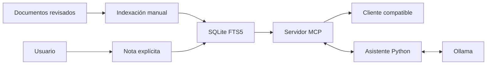

# mcp-inicio-ia

Servidor MCP con documentos, búsqueda local, notas y un asistente con Ollama.

Incluye instalación, datos de ejemplo, herramientas, recursos, un prompt de investigación, configuración de clientes, Docker y pruebas. El asistente utiliza el mismo MCP que se conecta a una aplicación externa.

| Componente | Implementación |
| --- | --- |
| Protocolo | SDK oficial de MCP para Python |
| Transporte | stdio local o por SSH |
| Documentos | Markdown y texto UTF-8 |
| Búsqueda | SQLite FTS5, sin servicio adicional |
| Memoria | Notas guardadas expresamente por el usuario |
| IA | Ollama con llamadas a herramientas |
| Fuentes | ID, ruta, líneas y SHA-256 |
| Pruebas | unittest y clientes MCP reales |



## Instalación

Requisitos mínimos de Python 3.12 y SQLite con FTS5. Las distribuciones utilizadas en las pruebas ya incluyen FTS5.

```sh
git clone https://github.com/em4nu3i69dll/mcp-inicio-ia.git
cd mcp-inicio-ia
python -m venv .venv
```

Activá el entorno en Linux o macOS.

```sh
source .venv/bin/activate
```

En PowerShell.

```powershell
.venv\Scripts\Activate.ps1
```

Instalá las dependencias y prepará el espacio.

```sh
python -m pip install -r requirements.txt
python -m pip install --no-deps .
python -m mcp_inicio preparar
python -m mcp_inicio comprobar
```

`preparar` crea `datos/contexto.sqlite3` e indexa la carpeta `contenido`. `comprobar` abre un cliente MCP real, inicia el servidor en un subproceso y consulta sus herramientas, recursos, prompts y estado.

## Conectar un cliente

```sh
python -m mcp_inicio configuracion
```

El comando genera un bloque `mcpServers` con la ruta absoluta del intérprete y del espacio. Incorporalo a la configuración de un cliente que admita ese formato. No lo publiques porque contiene rutas de tu máquina.

El comando que inicia el servidor es el siguiente.

```sh
python -m mcp_inicio --base /ruta/al/espacio servidor
```

El paquete debe estar instalado en ese intérprete. El servidor reserva stdout para el protocolo. No se debe ejecutar mediante una terminal que escriba saludos, banners u otros mensajes en stdout.

## Herramientas

| Herramienta | Entrada | Resultado |
| --- | --- | --- |
| `listar_documentos` | Página opcional | Veinte documentos con ID y hash |
| `buscar_documentos` | Texto y límite opcional | Fragmentos ordenados por relevancia |
| `leer_documento` | ID, línea inicial y cantidad | Contenido numerado, hasta cien líneas |
| `consultar_notas` | Página opcional | Cinco notas agregadas por el usuario |
| `estado_contexto` | Sin argumentos | Cantidades y capacidades del espacio |

Las herramientas no reciben rutas arbitrarias. La lectura utiliza el ID del documento indexado. Tampoco aceptan SQL, comandos, URLs ni código para ejecutar.

## Recursos y prompts

`inicio://contexto` describe el alcance del servidor y el uso de fuentes.

`inicio://documento/{identificador}` devuelve las primeras sesenta líneas de un documento. Para paginar se utiliza `leer_documento`.

El prompt `investigar` recibe una pregunta y prepara una consulta con búsqueda, lectura de fuentes y referencias. Es una plantilla de trabajo, no una barrera de seguridad.

## Agregar documentación

Copiá archivos revisados a `contenido` y actualizá el índice.

```sh
python -m mcp_inicio indexar
```

Para usar otra carpeta de documentos.

```sh
python -m mcp_inicio indexar --contenido /ruta/a/documentos
```

El índice se reemplaza en una transacción. Los archivos retirados desaparecen de la búsqueda. Las notas se conservan. No existe un observador de archivos en segundo plano ni una importación automática de todo el equipo.

Los ejemplos incluidos describen un proyecto ficticio llamado Faro. Reemplazalos por documentación propia antes de usar el servidor como fuente de información real.

## Preguntar con IA

Instalá Ollama y descargá el modelo local.

```sh
ollama pull qwen3.5:0.8b
python -m mcp_inicio preguntar "A qué hora se hacen los respaldos y qué retención tienen"
```

La salida incluye respuesta, fuentes consultadas con extractos numerados, nombres de las herramientas utilizadas y modelo. No guarda conversaciones por defecto.

El flujo abre un cliente MCP, obtiene la lista de herramientas, busca documentación y lee hasta tres fuentes antes de entregar la evidencia al modelo. El modelo puede pedir otras consultas dentro de la lista permitida. Los argumentos se validan con el esquema publicado por el MCP antes de llamar a la herramienta.

Hay un máximo de cinco rondas y cuatro llamadas por ronda. Si no hay documentos relacionados, el asistente informa que falta evidencia y no llama al modelo. Si el modelo devuelve herramientas inexistentes, argumentos incorrectos o una respuesta incompleta, la consulta falla sin ejecutar esa petición.

Para otro modelo o instancia de Ollama.

```sh
python -m mcp_inicio preguntar "Cómo se restaura la base" --modelo qwen3.5:4b --ollama https://modelo.example.com
```

La conexión remota a Ollama requiere HTTPS. HTTP se permite únicamente en loopback y para el nombre `ollama` dentro de Compose. El cliente no sigue redirecciones ni utiliza proxies del entorno.

Las fuentes adjuntas son las que devolvieron las herramientas. No garantizan que todas las frases del modelo sean correctas. Revisá los fragmentos antes de tomar una decisión operativa.

## Notas y auditoría

Guardá una nota desde un archivo de texto.

```sh
python -m mcp_inicio nota --titulo "Decisión de despliegue" --archivo decision.txt
python -m mcp_inicio auditoria
```

Guardar notas no es una herramienta del modelo. La auditoría conserva nombre de herramienta, fecha y resultado de la llamada. No registra preguntas ni contenido de documentos. Se retienen las últimas mil llamadas y se muestran cincuenta.

Las notas se consultan mediante paginación y no forman parte del índice FTS. Para convertir una nota en documentación buscable, incorporala manualmente a `contenido` y reindexá.

## Docker

```sh
mkdir datos
```

En Linux, el proceso del contenedor utiliza UID 1000 y necesita escribir en esa carpeta.

```sh
sudo chown 1000:1000 datos
docker compose build mcp
docker compose run --rm -T mcp preparar
docker compose run --rm -T mcp comprobar
```

Para un cliente MCP, utilizá `docker` como comando y estos argumentos, reemplazando la ruta del Compose por su ubicación absoluta.

```sh
docker compose -f /ruta/mcp-inicio-ia/compose.yaml run --rm -T mcp servidor
```

No se usa `docker compose up` para dejar el servidor stdio esperando conexiones de red. Cada cliente inicia su propio proceso. La entrada estándar debe permanecer abierta y no debe asignarse una TTY.

Para probar el asistente con el modelo de Compose.

```sh
docker compose --profile ia up -d ollama
docker compose exec ollama ollama pull qwen3.5:0.8b
docker compose run --rm -T mcp preguntar "Cómo se comprueban los respaldos" --ollama http://ollama:11434
docker compose --profile ia down
```

Compose no publica puertos del host. El MCP tiene una red interna, sistema de archivos de solo lectura y acceso de escritura únicamente a `datos`. Ollama tiene una red de salida para descargar modelos y un volumen propio. Su memoria y CPU están limitadas.

## Acceso por SSH

Instalá el paquete y prepará el espacio en el servidor. Configurá una cuenta dedicada con acceso únicamente a sus documentos y base de datos. La aplicación cliente inicia SSH sin asignar una terminal.

```sh
ssh -T usuario@servidor /opt/mcp-inicio-ia/.venv/bin/python -m mcp_inicio --base /srv/mcp-inicio servidor
```

Usá verificación de host y una identidad propia para cada integración. En una instalación compartida, restringí esa clave a un comando fijo y deshabilitá terminal y reenvíos. El repositorio no modifica usuarios, claves SSH ni permisos del host automáticamente.

Este proyecto no publica un endpoint HTTP MCP. Agregar Cloudflare Tunnel a stdio no lo convierte en HTTP. Para clientes exclusivamente HTTP se necesita otro transporte con autenticación y autorización implementadas y probadas.

## Límites de acceso

Cada espacio corresponde a un propietario. No hay separación multiusuario, inicio de sesión web ni administración de roles.

El MCP consulta la copia indexada, no archivos arbitrarios del sistema. Se omiten carpetas ocultas, enlaces, directorios privados conocidos y formatos distintos de Markdown y texto. También se rechazan claves privadas PEM detectadas durante la indexación.

Esa comprobación no es un detector completo de secretos. Revisá los documentos antes de indexarlos. Un token escrito dentro de un Markdown permitido podría quedar accesible a todos los clientes autorizados para ese espacio.

El servidor no ofrece shell, ejecución de código, escritura de fuentes ni SQL libre. Los documentos se tratan como datos no confiables y el modelo no recibe herramientas de escritura. Esto limita las acciones disponibles, pero no garantiza que el modelo interprete correctamente todo el texto.

## Límites operativos

- Hasta mil documentos y doscientos mil bytes por archivo
- Hasta diez resultados por búsqueda
- Lectura de hasta cien líneas y veinticuatro mil caracteres por llamada
- Hasta mil notas de ocho mil caracteres
- SQLite local con una conexión por operación y espera de cinco segundos ante bloqueos
- Búsqueda por palabras con FTS5, sin embeddings ni servicio vectorial

Resguardá `datos/contexto.sqlite3` con la API online de SQLite o con los procesos detenidos. La base incluye documentos y notas privadas. No la subas al repositorio ni la montes en un directorio público.

## Pruebas

```sh
python -m unittest discover -s pruebas -v
```

Las pruebas comprueban búsqueda, referencias, indexación, notas, permisos de lectura, recursos, prompts y conexión stdio en un subproceso real. El ciclo de herramientas del asistente también se prueba con respuestas controladas para reproducir errores y límites sin depender de un modelo.

## Estructura

| Carpeta | Contenido |
| --- | --- |
| `mcp_inicio` | Servidor, cliente, almacenamiento y comandos |
| `contenido` | Documentos ficticios para comenzar |
| `pruebas` | Pruebas reproducibles |
| `datos` | Base local generada, excluida de Git |

## Referencias

- [SDK oficial de MCP para Python](https://github.com/modelcontextprotocol/python-sdk)
- [Documentación del SDK](https://py.sdk.modelcontextprotocol.io/)
- [Llamadas a herramientas con Ollama](https://docs.ollama.com/capabilities/tool-calling)
- [SQLite FTS5](https://sqlite.org/fts5.html)

## Autor

Emanuel Duarte · [em4nu3i69dll](https://github.com/em4nu3i69dll)
